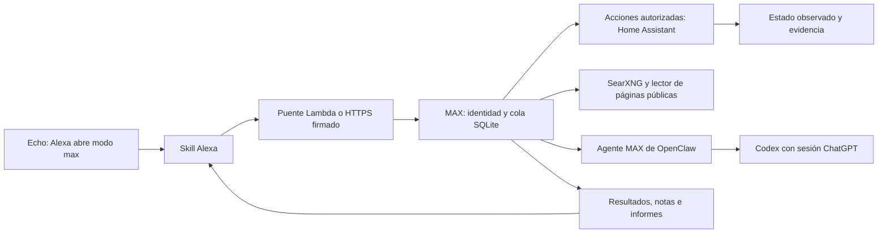

# MAX: instalación y operación

Esta entrega continúa el repositorio original LUTS-IA. El runtime nuevo está en
`max_runtime/`; las otras variantes históricas de PC se conservan. El puente Alexa
ya no utiliza GPT-3.5 ni una API key de OpenAI.

## Arquitectura instalada



La invocación de la skill es **modo max**: «Alexa, abre modo max». Cambiar la
palabra de activación de un Echo a «Max» no forma parte de esta integración.

El servidor escucha solo en `127.0.0.1:8787`. Administración y puente de voz usan
claves distintas. El endpoint HTTPS directo verifica firma y timestamp con el SDK
oficial de Amazon; ambos transportes comprueban además el Skill ID, usuario y
dispositivo. El receptor permanece cerrado hasta configurar los usuarios Alexa.

La entrada opcional `max-edge.service` escucha en loopback 8788 y publica solo
las rutas de voz. `max-tunnel.service` permite pruebas HTTPS mediante un Quick
Tunnel de Cloudflare, con configuración propia para no heredar túneles ajenos.
La URL de un Quick Tunnel cambia cuando ese proceso se reinicia; para uso diario
se requiere sustituirlo por un túnel con nombre y hostname estable. La API de
administración no se publica a través de esa entrada.

Cada petición tiene un ID único. Las repeticiones recuperan el mismo trabajo. Los
trabajos de una conversación se procesan en orden, y los resultados de voz se
buscan por usuario y Echo concreto. La sesión del modelo es nueva por trabajo:
el contexto permitido se toma de SQLite, no de agentes personales.

El agente OpenClaw dedicado tiene una lista finita de herramientas que restringe
las capacidades nativas de Codex. El modelo conversa e interpreta; la pasarela
ejecuta las acciones admitidas y observa su resultado. Las propuestas de acciones
del modelo sin una orden reconocida se convierten en una petición de aclaración.
Esta versión no entrega una shell a órdenes de voz.

## Instalación reproducible

Requisitos: Linux, Python 3.12+, Git, OpenClaw con su plugin Codex compatible y
sesión ChatGPT funcional; Docker para SearXNG. No se necesita API key de OpenAI.

```bash
gh repo clone maxchahuara/LUTS-IA ~/projects/LUTS-IA
cd ~/projects/LUTS-IA
python3 deploy/configure_agent.py
python3 deploy/install.py
~/.local/share/max/venv/bin/max-cli status
```

`requirements.lock` fija las dependencias probadas en Python 3.12.
`configure_agent.py` configura únicamente `max`, guarda una copia privada previa,
valida el cambio con OpenClaw y conserva los demás agentes. Usa un workspace
propio y `agents.entries.max.tools.allow: ["session_status"]`. Su plantilla de
instrucciones está en `deploy/max-agent.md`. El instalador del runtime no
sustituye esa configuración. Para otras instalaciones, adapta el modelo o el ID
con las opciones del script y verifica la restricción nativa del harness.

La configuración se genera en `~/.config/max/config.json` con permisos 0600.
`deploy/config.example.json` muestra el formato sin datos reales. Edita únicamente
el archivo privado. La memoria, informes y copias viven en `~/.local/share/max/`.
`max-cli` está en `~/.local/share/max/venv/bin/`.

Para SearXNG, copia `deploy/searxng.settings.yml` a un directorio privado y
sustituye la clave de ejemplo por una aleatoria. Fija `SEARXNG_IMAGE` al digest
verificado de la imagen oficial y `MAX_SEARXNG_CONFIG` al directorio privado.
Arranca `docker compose --env-file ARCHIVO_PRIVADO -f deploy/compose.yaml up -d`.
El buscador solo escucha en loopback; su API JSON se habilita en settings.yml.

## ChatGPT y Home Assistant

OpenClaw conserva y renueva su propia sesión OAuth. MAX invoca el agente `max` y
espera su resultado final, comprobando que no haya sido abortado. El recibo del
trabajo identifica proveedor, modelo y harness efectivos. Una lista de modelos
disponibles no sustituye una prueba real de inferencia.

`max-cli link-ha` crea un enlace de autorización de diez minutos. Abre el enlace
e inicia sesión en Home Assistant para conceder acceso a MAX. El callback por
defecto es `http://localhost:8787/setup/ha/callback`. Si administras Linux desde
otra PC, abre un túnel SSH local al puerto 8787 antes de autorizar. El refresh
token queda exclusivamente en el archivo privado; MAX renueva el access token
cuando hace falta. Puedes revocar el acceso desde tu perfil de Home Assistant.

Configura una lista explícita `entities` con nombres lógicos, aliases y acciones.
Solo se admiten `light`, `switch`, `media_player` y `scene`. Los reproductores
permiten volumen de 0 a 60 %. Las escenas informan recepción de la orden y no
se presentan como estados finales verificados. No hay control genérico de
cerraduras, alarmas, compras o llamadas a servicios arbitrarios.

En LG, añade la integración **LG webOS TV**, acepta el emparejamiento en la TV y
comprueba su entidad. Detectar la TV por Cast no asegura encendido ni control
completo. El encendido puede requerir la opción correspondiente en la TV,
Wake-on-LAN o HDMI-CEC. Para Fire TV con ADB, habilita y acepta depuración en cada
equipo; no actives ADB de manera indiscriminada en la red.

## Alexa

Importa `1 LUTSIA-ALEXA/JSON_Editor.js` como modelo de interacción JSON del idioma
español correspondiente. El nombre del archivo se conserva para compatibilidad
con la guía original. Contiene frases portadoras válidas para `AMAZON.SearchQuery`.

Hay dos transportes alternativos:

- Lambda: publica `lambda_function.py` con Python 3.12+. Restringe el trigger
  Alexa Skills Kit al Skill ID. Configura `ALEXA_SKILL_ID`, `MAX_BASE_URL` HTTPS y
  `MAX_BRIDGE_TOKEN`. El puente espera hasta tres segundos, solo para encolar.
- HTTPS directo: termina TLS con un certificado válido y publica únicamente
  `/alexa`. MAX valida firma y timestamp. Mantén cerradas las rutas administrativas.

Configura `alexa_skill_id` y `alexa_users` en Linux con los IDs reales de la cuenta
y skill. No uses valores de prueba ni inscripción automática del primer usuario.
No publiques los IDs privados, claves ni el inventario de la casa. Si la skill
anterior está publicada y Amazon impide cambiar su invocación, crea una nueva
skill «modo max» conservando este mismo repositorio e historial Git.

Para las pruebas físicas, habilita la versión de desarrollo y usa una cuenta y
un idioma compatibles en el Echo. En la app Alexa, busca la skill en **Tus
skills → Dev** y habilítala. La [guía oficial de pruebas](https://developer.amazon.com/en-US/docs/alexa/test/test-your-skill-overview.html)
describe los requisitos de cuenta e idioma. Un resultado correcto en el simulador
no prueba por sí solo que un Echo de otra cuenta o idioma invoque esa misma skill.

`owner_alexa_user`, si se configura explícitamente con uno de los usuarios
autorizados, comparte el perfil de notas y trabajos de ese usuario con la API y
CLI del operador. Si queda vacío, el perfil local y los perfiles Alexa permanecen
separados. Los resultados de voz se mantienen ligados al Echo que los solicitó.

Para identificar cada Echo de la casa, di en ese equipo: «Alexa, abre modo max y
consulta identifica este dispositivo como Echo de la sala». `max-cli echoes`
muestra los orígenes autenticados y sus etiquetas. La etiqueta es declarada por
el usuario y no constituye una identificación automática del modelo de hardware.
`max-cli discover` complementa el inventario con anuncios mDNS y SSDP, sin
inscribir equipos ni enviar órdenes físicas.

Una investigación puede tardar más que el plazo de Alexa. MAX acusa recibo,
trabaja en segundo plano y permite «consulta mi resultado». Salir de la skill no
borra el trabajo. Cancelarlo no revierte acciones ya enviadas.

## Uso y diagnóstico

```bash
max-cli status
max-cli discover
max-cli devices
max-cli echoes
max-cli ask "hola Max, qué puedes hacer" --wait
max-cli ask "busca en internet cómo funciona Home Assistant" --wait
max-cli ask "enciende la tv de la sala" --wait
max-cli ask "pon el volumen de la tv de la sala al 25" --wait
max-cli ask "abre Netflix en la tv de la sala" --wait
max-cli ask "recuerda que prefiero respuestas cortas" --wait
max-cli ask "qué recuerdas" --wait
max-cli jobs
max-cli result ID
max-cli cancel ID
max-cli backup
systemctl --user status max.service
journalctl --user -u max.service -n 50 --no-pager
```

La API administrativa autenticada expone `/v1/status`, `/v1/requests`,
`/v1/jobs`, `/v1/jobs/ID`, `/v1/jobs/ID/cancel`, `/v1/jobs/ID/report`, `/v1/devices`
y `/v1/notes`. El informe Markdown se descarga con la misma autenticación.
Las notas se crean solo mediante petición explícita; pueden consultarse y borrarse.
Los trabajos se conservan 30 días por defecto; las notas no se borran con esa
retención. Los informes y backups requieren limpieza explícita del operador.

Después de un reinicio, los trabajos en cola continúan y los que estaban en
ejecución se marcan interrumpidos. Nunca se reenvían automáticamente acciones
cuyo resultado sea incierto. Se conserva su evidencia. Cancelar una inferencia
detiene la espera local; el proveedor podría completar el cálculo ya enviado.

## Alcance y siguientes incrementos

La entrega inicial cubre conversación, búsqueda con fuentes, informes Markdown,
notas explícitas, trabajos persistentes y acciones domésticas acotadas. Son
extensiones posteriores: reproducción proactiva en el Echo exacto mediante
`alexa_devices`, rutinas complejas aprobadas, calendarios, documentos Office,
visión, voz local con una palabra de activación propia, y agentes de programación
con entornos aislados y permisos separados del hogar.

El plan de investigación describe más componentes candidatos; su presencia en
ese documento no implica que ya estén instalados, conectados o probados. La
matriz de validación de cada entrega identifica las pruebas reales realizadas.

## Licencias

El código nuevo de MAX, los nuevos puentes, skills y su documentación operativa
se distribuyen bajo la licencia MIT en `max_runtime/LICENSE`. Las otras variantes
históricas conservan su situación de licencia; no se atribuyen licencias nuevas a
dependencias o código ajeno. SearXNG se ejecuta como componente separado bajo
AGPL-3.0, OpenClaw y las bibliotecas conservan sus licencias respectivas. No se
incluye código del DevKit SiWC con licencia no comercial ni se copian skills de
terceros sin su licencia.

La dependencia `oscrypto` se fija a un commit del repositorio oficial que corrige
la detección de OpenSSL 3 con versiones de dos dígitos. Véase el
[issue del proyecto](https://github.com/wbond/oscrypto/issues/78). No se desactiva
la verificación criptográfica de las peticiones Alexa para evitar ese problema.
