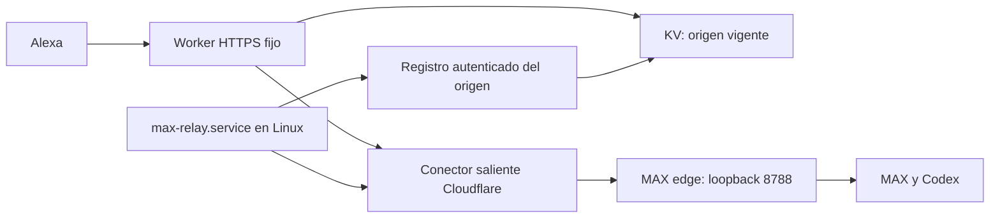

# MAX con una URL HTTPS fija de Workers

Esta opción de MAX 0.1.2 usa una dirección
`https://nombre.cuenta.workers.dev` en tu cuenta de Cloudflare. No requiere un
dominio propio ni abrir puertos del router. El código del puente está en
`deploy/cloudflare/worker.mjs` y se distribuye bajo MIT; Workers y KV son
servicios alojados de Cloudflare.



El proceso saliente obtiene una dirección interna temporal, comprueba la salud
de MAX y registra esa dirección en el Worker. Alexa utiliza siempre la URL del
Worker. Al reiniciar el conector, cambia el destino registrado automáticamente;
no se modifica la configuración de la skill ni se escriben commits al arrancar.

## Preparación en Cloudflare

1. En **Workers & Pages**, crea un Worker dedicado con el nombre elegido.
   Utiliza el plan gratuito y conserva su dirección `workers.dev`.
2. Crea un namespace KV dedicado y vacío, por ejemplo `max-alexa-relay`.
   En los bindings de producción del Worker, vincúlalo como **MAX_RELAY**.
3. Instala el runtime en Linux según [operación](OPERACION.md). Ejecuta:

   ```bash
   cd ~/projects/LUTS-IA
   ~/.local/share/max/venv/bin/python deploy/configure_relay.py https://nombre.cuenta.workers.dev
   ```

   El script genera un token aleatorio en `~/.config/max/relay.json` con permisos
   0600. Si ya existe una identidad, la conserva. Solo muestra su SHA-256.
   También instala las unidades de entrada restringida y conector de usuario.
4. En las variables de producción del Worker, configura
   **REGISTER_TOKEN_SHA256** con ese verificador. El token original permanece
   únicamente en Linux y nunca debe copiarse a Git ni al código del Worker.
5. En **Edit code**, publica el contenido de `deploy/cloudflare/worker.mjs`.
   La plantilla `wrangler.example.jsonc` permite reproducir la configuración con
   Wrangler si prefieres esa herramienta; los IDs y la configuración reales
   deben conservarse fuera del repositorio.

El Worker solo utiliza su namespace dedicado. No necesita acceso a GitHub,
credenciales administrativas de Cloudflare, Home Assistant ni la sesión ChatGPT.
Su registro no guarda preguntas ni respuestas: contiene solo el origen vigente
y la fecha de actualización. El código no escribe cuerpos ni tokens en logs.

## Arranque en Linux

`max-relay.service` supervisa el proceso `cloudflared` y registra cada origen
nuevo. `cloudflared` utiliza un archivo de bootstrap vacío para evitar heredar
otros túneles y solo publica el puerto restringido 8788. El supervisor borra las
variables de entorno de otros túneles antes de iniciar el proceso.

```bash
systemctl --user enable --now openclaw-gateway.service max.service max-edge.service max-relay.service
loginctl show-user "$USER" -p Linger
journalctl --user -u max-relay.service -n 30 --no-pager
curl --fail https://nombre.cuenta.workers.dev/health
```

La permanencia de usuario debe devolver `Linger=yes`, según la
[guía de arranque](HTTPS-Y-ARRANQUE.md). MAX espera a que OpenClaw complete su
inicialización; el registro reintenta si aún no tiene red o el receptor no está
listo. systemd recupera el supervisor y su conector si terminan.
El arranque puede tardar varios minutos si el gateway compartido está preparando
sus catálogos y bases de agentes. Si supera el primer plazo de espera, MAX vuelve
a intentar automáticamente; el endpoint de salud sigue en 503 hasta estar listo.

Una vez verificada la URL, configura el endpoint HTTPS de desarrollo de Alexa
como `https://nombre.cuenta.workers.dev/alexa`. Guarda esa URL base en el campo
informativo `public_url` del JSON privado del runtime. Conserva la invocación
«modo max» y las comprobaciones de usuario, skill, firma y timestamp.

Cuando la nueva entrada ya funcione, detén y deshabilita los conectores anteriores
propios de MAX que hayas usado para la migración. No modifiques túneles de otras
aplicaciones. En esta modalidad se habilita `max-relay.service`; la unidad
`max-tunnel.service` queda como alternativa para instalaciones con dominio.

## Comprobación después de reiniciar

Antes del reinicio, guarda una copia con `max-cli backup` y registra el ID de
arranque de `/proc/sys/kernel/random/boot_id`. Conserva también una copia privada
de `~/.config/max/relay.json`: la identidad del conector no se incluye en el
backup del runtime. Ambos archivos deben permanecer fuera de Git.
Reinicia Linux de forma ordenada.
Después, verifica un ID nuevo y servicios activos sin arrancarlos manualmente:

```bash
systemctl --user is-active max.service max-edge.service max-relay.service openclaw-gateway.service
curl --fail https://nombre.cuenta.workers.dev/health
~/.local/share/max/venv/bin/max-cli status
~/.local/share/max/venv/bin/max-cli ask "Confirma en una frase que MAX está disponible" --wait
```

Comprueba también una invocación real del simulador de Alexa con su endpoint
guardado previamente. `/v1/status` debe seguir devolviendo 404 desde Internet y
`/alexa` debe rechazar peticiones sin firma. El registro `/internal/relay` debe
devolver 404 sin la identidad privada del conector. Un registro autenticado solo
acepta un origen HTTPS `trycloudflare.com` cuya salud identifique a MAX.

## Límites y diagnóstico

El plan gratuito de Workers tiene una cuota diaria de peticiones. KV tiene sus
propias cuotas de lecturas y escrituras; registra solo los cambios de origen y
no necesita escribir en cada consulta de voz. El código no contrata planes ni
habilita facturación de pago. Consulta los límites vigentes de
[Workers](https://developers.cloudflare.com/workers/platform/limits/) y
[KV](https://developers.cloudflare.com/kv/platform/limits/).

KV propaga sus cambios entre regiones: puede existir un intervalo adicional de
recuperación después de reiniciar el conector. Durante la interrupción, la salud
responde 503 y el Worker no presenta el servicio como disponible. El conector no
repite trabajos ni acciones; esa recuperación continúa en la cola de MAX.

La administración, los tokens, los informes y los backups del runtime permanecen
locales. El token del registro sirve únicamente para actualizar este origen;
no concede acceso a la API doméstica ni a la administración de Cloudflare.

```bash
journalctl --user -u max.service -u max-edge.service -u max-relay.service -n 80 --no-pager
```
